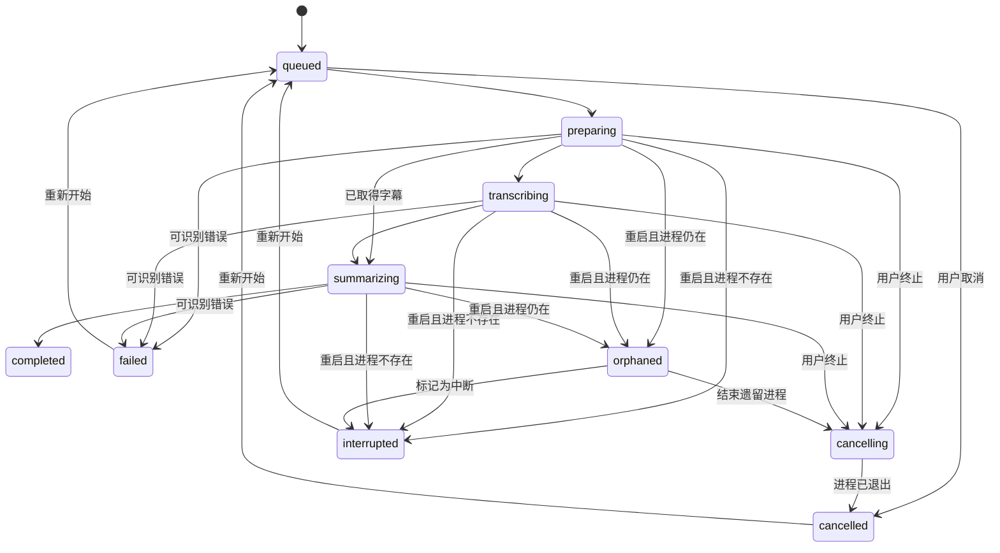

# 视频解析任务生命周期设计

> 状态：已确认（2026-07-29）

## 目标

任务在应用退出、崩溃或用户主动终止后，必须显示真实状态；遗留子进程及临时媒体必须可被终止和清理。首版不支持断点续跑。

## 产品原则

1. “处理中”仅是界面汇总，不是数据库状态。
2. 任务重启后绝不自动续跑，也不尝试从中间进度恢复。
3. 用户主动停止与异常中断必须区分，方便判断是否需要重试。
4. 任务结果与临时资源清理分别记录；清理失败不能把已完成任务误标为处理中。

## 任务状态

| 状态 | 含义 | 用户操作 |
|---|---|---|
| `queued` | 已创建，等待启动。 | 取消 |
| `preparing` | 正在读取元数据、获取字幕或准备媒体。 | 终止 |
| `transcribing` | 正在解析或本地转写。 | 终止 |
| `summarizing` | 正在生成结构化笔记。 | 终止 |
| `cancelling` | 已请求停止，等待后台子进程实际退出。 | 等待 |
| `completed` | 字幕与笔记已保存。 | 查看、删除 |
| `failed` | 运行时返回了可识别错误。 | 重新开始、删除 |
| `interrupted` | 应用启动核验时，发现原运行任务的进程不存在。 | 重新开始、删除 |
| `orphaned` | 应用启动核验时，发现旧子进程仍存在，但新会话不能接管。 | 结束遗留进程、标记中断 |
| `cancelled` | 用户终止的子进程已退出。 | 重新开始、删除 |

`preparing`、`transcribing`、`summarizing` 与 `cancelling` 在界面上统一归类为“处理中”。

## 状态转移

## 启动校验与终止规则

每个运行任务保存运行标识、子进程 PID、启动时间和最后心跳时间。应用启动时，逐个校验 PID 与运行标识：

- 进程不存在：直接从运行状态迁移到 `interrupted`，并提示“应用关闭后任务未完成”。
- 进程仍存在：迁移到 `orphaned`；不得继续显示为正常处理中，也不得尝试接管或续跑。
- 对 `orphaned` 显示“结束遗留进程”。终止时先发送正常退出信号，超时后强制结束；确认退出后迁移为 `cancelled`。

终止按钮在 `preparing`、`transcribing`、`summarizing` 与 `orphaned` 可用。点击后应立刻禁用重复操作并进入 `cancelling`。若终止命令失败，保留 `orphaned` 并展示可读错误。

## 资源清理

任务表之外单独保存资源清理状态：`pending`、`cleaning`、`cleaned`、`cleanup_failed`。任务进入 `completed`、`failed`、`interrupted` 或 `cancelled` 后触发临时音频、下载媒体和锁文件清理。清理失败应保留错误和“再次清理”操作，但不改变任务的业务状态。

## 非目标

- 不支持断点续跑。
- 不恢复或接管应用重启前启动的旧进程。
- 不在首版同时处理多个视频任务。
